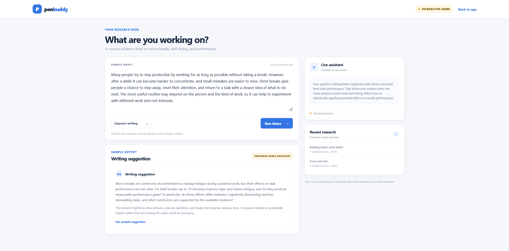
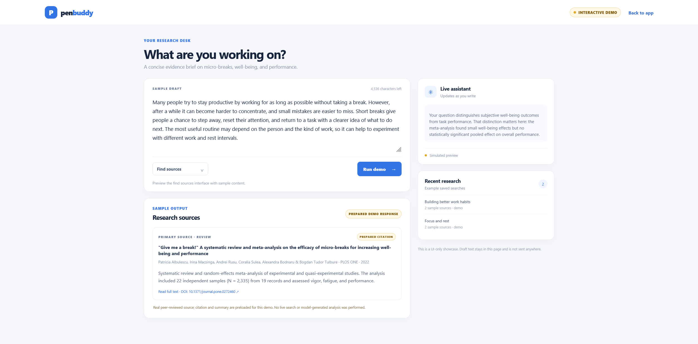
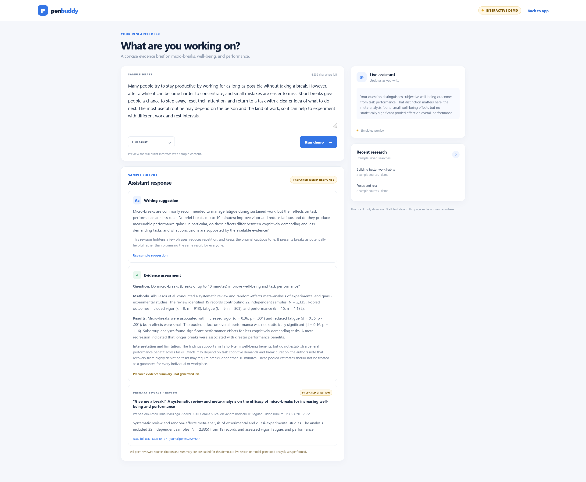

# Writing Assistant

A modular tool for writers and researchers to organize ideas, find sources, and improve their writing.

## Demo

Screenshots of the writing, source-search, and full-assist workflows:

### Improve writing



### Find sources



### Full assist



## Features

| Feature | Details | Status |
|---|---|---|
| Source search | Search engines, preferred sites, reference generation | In progress |
| Fact-checking | Verify claims and compare sources | Planned |
| Writing support | Suggestions for overcoming writer's block | Planned |
| Grammar & editing | Improve clarity and language quality | Planned |
| Web interface | Simple interface for research and writing workflows | Planned |

## User authentication

User accounts are stored in the configured JPA database. Passwords are hashed with BCrypt, and successful registration or login returns a short-lived JWT bearer token.

Set `JWT_SECRET` to a Base64-encoded secret containing at least 32 random bytes before starting the application. For example, generate one with `openssl rand -base64 32`. Keep the value private and do not commit it.

To run the app and PostgreSQL with Docker Compose, use the clickable tasks in [COMMANDS.md](./COMMANDS.md), or initialize a private local `.env` file and start the stack manually:

```bash
bash scripts/init-local-env.sh
bash ./mvnw -DskipTests package
docker compose up -d --build
```

The setup script generates database and JWT secrets and refuses to overwrite an existing `.env`. Add `FIRECRAWL_API_KEY` there to enable web search through Firecrawl. Compose connects the app to PostgreSQL and publishes it at `http://localhost:3000`. The `.env` file is ignored by Git; keep it private.

- `POST /api/auth/register` with `email` and `password` creates an account and returns a token.
- `POST /api/auth/login` with `email` and `password` returns a token.
- Send the token as `Authorization: Bearer <token>` when calling protected endpoints.

Registration requires a password of 12 to 64 characters and rejects values exceeding BCrypt's 72-byte input limit. Tokens expire after 15 minutes.

## Live writing assistance

The writing assistant searches the web through Firecrawl, checks claims against search sources, and suggests grammar edits using the configured Spring AI chat model. Set `FIRECRAWL_API_KEY` to enable web search; Firecrawl plan limits apply. Make an Ollama server available with the model named by `OLLAMA_MODEL` (default `llama3.2`). With Docker Compose, the app connects to Ollama on the host via `host.docker.internal`; set `OLLAMA_BASE_URL` if yours is elsewhere. The WebSocket endpoint is `/ws/writing-assistant`; connect, send `{"token":"<JWT>"}` as the first message, then send `{"text":"...","action":"ASSIST"}` as the user edits. Supported actions are `ASSIST`, `SEARCH`, `FACT_CHECK`, and `GRAMMAR`. Updates are debounced for one second and stale results are discarded.

## System Architecture

flowchart TB
    U["User"] --> UI["Web Interface"]
    UI --> AUTH["Authentication REST API"]
    AUTH --> AS["Auth Service"]
    AS --> JPA["Spring Data JPA"]
    JPA --> DB[("PostgreSQL")]
    AS --> JWT["JWT Bearer Token"]
    JWT --> UI

    UI --> WS["WebSocket Writing Assistant"]
    WS --> VALIDATE["JWT Validation"]
    VALIDATE --> ASSIST["Writing Assistant Service"]
    ASSIST --> DEBOUNCE["Debounce and Stale Result Control"]

    DEBOUNCE --> SEARCH["Source Search"]
    DEBOUNCE --> FACT["Fact Checking"]
    DEBOUNCE --> GRAMMAR["Grammar and Editing"]

    SEARCH --> FC["Firecrawl API"]
    FACT --> FC
    FC --> WEB["Web Search Sources"]

    FACT --> AI["Spring AI"]
    GRAMMAR --> AI
    AI --> OLLAMA["Ollama LLM"]

    COMPOSE["Docker Compose"] -.-> APP["Spring Boot Container"]
    COMPOSE -.-> PG["PostgreSQL Container"]
    APP -.-> WS
    PG -.-> DB

    classDef frontend fill:#dbeafe,stroke:#2563eb,color:#1e3a8a
    classDef backend fill:#dcfce7,stroke:#16a34a,color:#14532d
    classDef external fill:#fef3c7,stroke:#d97706,color:#78350f
    classDef database fill:#f3e8ff,stroke:#9333ea,color:#581c87

    class U,UI frontend
    class AUTH,AS,JWT,WS,VALIDATE,ASSIST,DEBOUNCE,SEARCH,FACT,GRAMMAR backend
    class FC,WEB,AI,OLLAMA external
    class JPA,DB database
